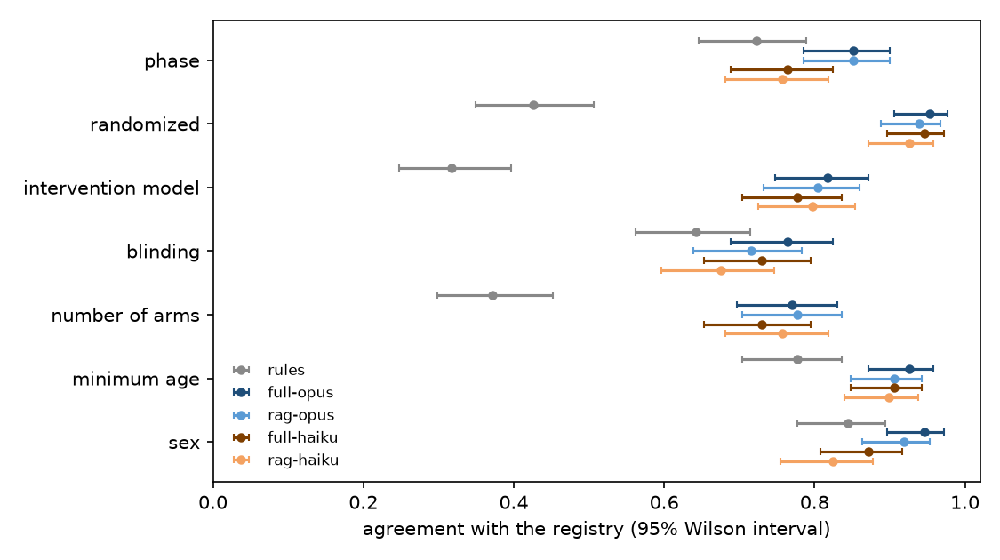
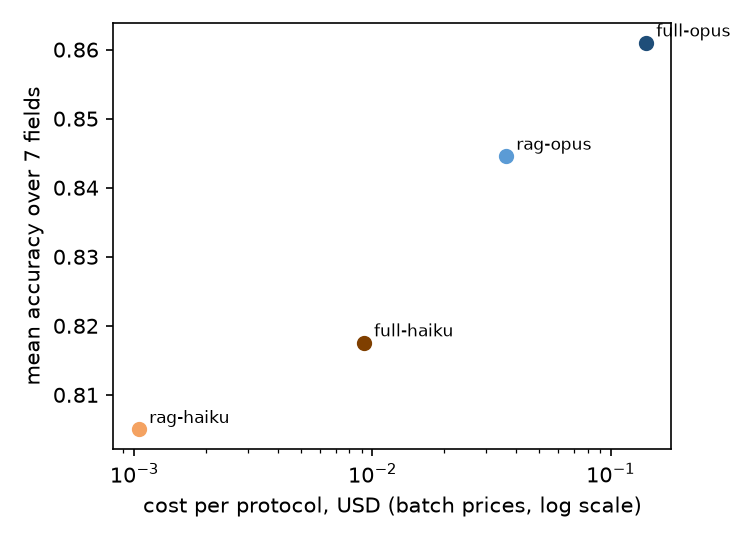

# Readout: extracting trial design fields from protocol PDFs, full text vs retrieval

The plan is [design.md](design.md), with Amendments 1 and 2 written before any evaluation output was scored. Everything marked post hoc was decided after the results below were seen. No prompt or retrieval setting was changed after the pilot.

## Sample

Of the 150 evaluation protocols, 148 had a text layer (98.7%; one 2-page PDF with 180 characters and one 109-page scan). All 592 evaluation requests (148 protocols x 4 LLM methods) returned; 591 parsed and one was a refusal (Opus 5.5 with full text on NCT01375114), scored as wrong on every field as Amendment 1 says.

The Opus 5.5 batches waited in the batch queue for several hours before processing (about 7 hours for the pilot batches, 3.5 for the evaluation batches); the Haiku 5.5 batches finished within an hour.

## Agreement with the registry

Mean over the seven fields, per protocol, then averaged over the 148 protocols:

| method | mean agreement | median input tokens | cost per protocol (batch) |
|---|---|---|---|
| Opus 5.5, full text | 86.1% | 59,860 | $0.141 |
| Opus 5.5, RAG | 84.5% | 16,663 | $0.036 |
| Haiku 5.5, full text | 81.8% | 59,860 | $0.009 |
| Haiku 5.5, RAG | 80.5% | 16,663 | $0.001 |
| rules | 58.6% | | |

The LLM methods beat the rules most on the fields that need reading rather than keyword matching: randomization (93-95% vs 43%), intervention model (78-82% vs 32%) and number of arms (73-78% vs 37%). Blinding was the hardest field for every method (68-76%).

The whole evaluation cost $27.70 at batch prices ($20.81 of it for Opus with full text), and the pilot $1.02.

## Verdicts

| id | check | result | verdict |
|---|---|---|---|
| P1 | protocols with extractable text, at least 90% | 98.7% | met |
| P2 | every LLM method beats rules, lower bound above 0 | +0.22 to +0.28, every lower bound at least +0.18 | met |
| P3 | RAG vs full text with Opus 5.5, lower bound above -0.03 | -0.016 (-0.032 to -0.003) | failed |
| P4 | RAG input tokens over full text, Opus 5.5, median at most 25% | 27.9% | failed |
| P5 | quotes found in the text, Opus 5.5 with RAG, at least 95% | 98.0% | met |
| P6 | Haiku 5.5 vs Opus 5.5 with RAG, lower bound above -0.05 | -0.040 (-0.053 to -0.027) | failed |
| P7 | tests in continuous integration and in the Docker image | 11 tests pass locally; the CI workflow and the Docker image were not run | not checked |

P3 failed narrowly: retrieval cost Opus 1.6 points of agreement on average, and the lower end of the interval reached 3.2 points against a limit of 3. P4 failed by 2.9 points: the four chunks per field gave about 16,700 tokens, 28% of the median full text. P6 failed: Haiku with retrieval was 4.0 points behind Opus with retrieval.

Per field (exact McNemar), the RAG vs full-text difference for Opus was not significant on any field; the largest was blinding (3 protocols right only with RAG, 10 only with full text, p = 0.09). Haiku vs Opus with RAG differed on phase and sex (0 vs 14 protocols each, p = 0.0001) and on nothing else.

## Why Haiku and retrieval lose points (post hoc)

`scripts/posthoc.py`, written after the results above were seen.

- **"Not stated" where the registry has a convention.** On the 14 phase and 14 sex disagreements between Haiku and Opus, Haiku answered "not stated" every time; Opus answered "not applicable" for a study with no drug phase and "all" when both sexes were eligible, which is how the registry codes them. Haiku with RAG answered "not stated" for 17% of phases and 16% of sexes, Opus with RAG for 7% of both. Blinding is the same story for every method: open-label protocols often never say so, and 21-28% of blinding answers were "not stated".
- **Scored with the registry's defaults** (not stated read as "not applicable" for phase, "all" for sex and "open label" for blinding), agreement rises to 87-89% for every LLM method and the gaps shrink: RAG vs full text with Opus -0.004 (-0.016 to 0.007), Haiku vs Opus with RAG -0.013 (-0.023 to -0.004). Under that scoring P3 and P6 would be met. This is not the planned scoring, and the verdicts above stand; it says the remaining gap is mostly a prompt that does not state the registry's conventions, which can be fixed and then tested on new protocols.
- **A garbled text layer.** NCT01375114 passed the 2,000-character filter, but its PDF fonts map to control characters, so the extracted text is unreadable (28% letters or spaces, against at least 69% for every other protocol). Three methods answered "not stated" on every field, and Opus with full text was refused. Dropping it changes no conclusion.

## Registry vs protocol

On 108 field values in 74 protocols, all four LLM methods agreed with each other and not with the registry. As planned, these are counted, not adjudicated. 45 of them are "not stated" answers (above) and 7 come from the garbled protocol. Many of the rest look definitional: the methods answered "sequential" where the registry says "single group" on 7 protocols, and arm counts differ in both directions, up to 15 and 23 registry arms on two protocols where the methods found 3 and 10.

## What this means for using it

1. For a first pass over many protocols, Haiku with retrieval costs a tenth of a cent per protocol and gets 80% of fields right without any tuning; Opus with full text gets 86% at $0.14.
2. Retrieval cuts input tokens by 72% for a 1.6-point loss with Opus; the loss sits mostly on blinding (10 protocols right only with full text, 3 only with RAG).
3. Say the registry's conventions in the prompt (no phase means "not applicable", no restriction means "all", no masking statement means open label). That is the cheapest fix and should be tested on protocols outside these 148.
4. Screen PDF text quality on the share of readable characters, not only on length.
5. Keep the quotes: 98% of Opus RAG answers came with a quote found in the protocol, which makes checking by a person fast.

## Limitations

The registry is an imperfect answer key, and its disagreements with the protocols were not adjudicated, so all agreement figures are lower bounds on accuracy against the protocol. The sample is cancer interventional studies with an uploaded protocol. Seven fields is a small part of what a protocol review needs. The batch queue wait for Opus 5.5 is a practical cost for time-sensitive work.
