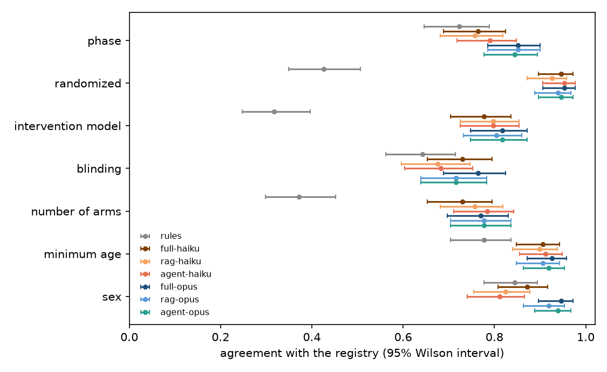

# Readout, part 2: an agent that decides what to read

The plan is [design_agent.md](design_agent.md), with Amendment 1 written after the pilot and before any evaluation request. Everything marked post hoc was decided after the results below were seen. Part 1 is in [readout.md](readout.md).

## Runs

All 148 evaluation protocols ran with both models. The evidence step made a median of 6 tool calls with Haiku 5.5 (at most 12) and 4 with Opus 5.5; one Opus run reached the 12-call limit. No evidence step was refused. One extraction failed: Opus refused the protocol with the garbled text layer (NCT01375114), as it did in part 1, which counts as wrong on every field.

Part 2 cost $20.08 with the pilot: $0.80 for 148 Haiku protocols ($0.005 each) and $18.64 for 148 Opus protocols ($0.126 each), at standard prices because an agent loop cannot go through the Message Batches API.

## Agreement with the registry

| method | mean agreement | cost per protocol, standard prices |
|---|---|---|
| Opus 5.5, full text | 86.1% | $0.281 |
| Opus 5.5, agent | 85.1% | $0.126 |
| Opus 5.5, RAG | 84.5% | $0.073 |
| Haiku 5.5, agent | 81.9% | $0.005 |
| Haiku 5.5, full text | 81.8% | $0.018 |
| Haiku 5.5, RAG | 80.5% | $0.002 |
| rules | 58.6% | |

Part 1 ran at batch prices; this table doubles those costs so that every row is at standard prices.

## Verdicts

| id | check | result | verdict |
|---|---|---|---|
| K1 | agent vs fixed RAG, Haiku, lower bound above 0 | +0.014 (-0.002 to +0.031) | failed |
| K2 | agent vs full text, Haiku, lower bound above -0.03 | +0.001 (-0.014 to +0.014) | met |
| K3 | input tokens, agent over full text, Haiku, median at most 50% | 111% | failed |
| K4 | quotes found in the text, Haiku agent, at least 95% | 94.5% | failed |
| K5 | agent vs fixed RAG, Opus, all 148, lower bound above 0 | +0.007 (-0.005 to +0.020) | failed |
| K5, first 50 | the same on the first 50, as first planned | 0.000 (-0.011 to +0.011) | failed |
| K6 | tests in continuous integration and in the Docker image | 16 tests pass on Python 3.10 and 3.12 in GitHub Actions and inside the Docker image | met |

The agent did not beat fixed retrieval with either model: with Haiku it gained 1.4 points, and the interval reached just below 0; with Opus it gained 0.7. With Haiku it matched the full text (K2) at under a third of the full-text cost.

K3 failed for a reason the check did not anticipate. An agent sends its whole conversation again on every turn, so the median Haiku protocol used 46,000 input tokens in the evidence step and 14,000 in the extraction, about as many as the full text. 63% of the evidence-step tokens were cache reads, billed at a tenth of the input price, which is why the cost is a third of the full text's while the token count is not lower. The check counts tokens, as written, and fails.

K4 failed narrowly: 94.5% of the Haiku agent's quotes were found word for word, and 96.6% with punctuation removed.

## Where the agent helped

Exact McNemar tests per field, agent vs fixed RAG with Haiku (protocols right only with the agent vs only with RAG): phase 7 vs 2, randomization 4 vs 0, number of arms 5 vs 1, minimum age 2 vs 0, intervention model 4 vs 4, blinding 3 vs 2, sex 5 vs 7. No field reached p < 0.05. The gains came where a fixed query misses the page that holds the answer, such as the title page for the phase or the schema for the arms; the agent searched for those directly.

## Expectations written in advance

- E1, the agent gains most on blinding: wrong. Blinding barely moved (3 vs 2 with Haiku, 3 vs 3 with Opus). As in part 1, the blinding losses are open-label protocols that never say so, which is a question of how the extraction prompt treats silence, not of what is retrieved.
- E2, the agent does not remove Haiku's "not stated" answers on phase and sex: held. Haiku answered "not stated" for 13.5% of phases (16.9% with fixed RAG) and 16.2% of sexes (the same as with fixed RAG).
- E3, the agent costs more than fixed RAG and less than the full text: held for both models.

## Registry defaults (post hoc)

Scored with the registry's defaults from part 1 ("not stated" read as "not applicable" for phase, "all" for sex and "open label" for blinding), the Haiku agent agrees on 88.6% of fields and the Opus agent on 89.1%, and the Haiku agent is then ahead of Haiku with the full text by 1.4 points (+0.3 to +2.5). That is not the planned scoring and the verdicts above stand, but it puts a cheap configuration, the Haiku agent with the conventions stated in the prompt, within half a point of the Opus agent at about 1/23 of its cost. It needs testing on protocols outside these 148.

## What this means

1. Letting the model choose what to read is not worth it with a strong model here: fixed BM25 retrieval with Opus is cheaper and as good.
2. With a small model, the agent recovers the full-text result at a third of the cost, mainly by finding the title page and the trial schema.
3. Count tokens and cost separately for agents: caching makes a loop cheap while its token count stays high.
4. The largest gain on offer is still in the extraction prompt (stating the registry's conventions), not in retrieval.

## Limitations

Each protocol ran once, so the run-to-run variation of the agent is not measured. The agent has one search tool (BM25) and a page reader; an embedding search or a table-of-contents tool might do better. The comparison with part 1 mixes synchronous and batch requests; costs are put on one basis above, but the batch queue (up to seven hours for Opus in part 1) is a cost the agent does not pay.
